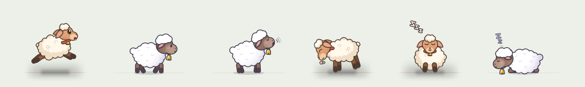

# Mouflon

**A light and beautiful desktop companion manager.**<br>
*Un gestionnaire de compagnons de bureau, léger et beau.*

[English](#english) · [Français](#français)



## English

Mouflon brings little companions to your Mac. They drop from the top of the
screen, stroll along your windows and ride with them when you move them, climb
the edges of the screen, graze, bleat, doze off — and let you catch them and
throw them across the desktop.

- **Light**: a native menu bar app. On a Mac, each screen has a single
  transparent window, and each pet is a few Core Animation layers showing
  shared images (its current frame, its shadow, its particles): the
  system's compositor draws them, and Mouflon only tells it what moved. The
  simulation and the layers run on their own display thread, woken by the
  screen's clock, and questions to the system about other apps' windows go
  through a helper process: nothing holds up a frame. A vector pet is baked
  into images when it loads, one per moving piece (head, legs, tail…), so
  it is shown the same way. At launch, each kind of pet decodes its sheets
  on its own threads, one row of tiles at a time, while the menu gets
  ready. Its images are then compressed to BC7 in the background (four
  times less memory) and kept on disk, mapped back in from there: the next
  launches find them ready in about ten milliseconds, even after the app is
  moved or updated, and those pages do not count in the app's memory
  footprint (the layers get them back decompressed, within a set budget).
  Frames follow the display's own clock (its full rate for brisk moves,
  half a ProMotion display's rate for a stroll, 30 fps at rest, 20 fps
  asleep), and a layer changes only when what it shows changes.
- **Beautiful**: continuous 120 Hz physics, timed to the moment each image
  reaches the display (ProMotion included), sub-pixel motion, in-between
  images for smoother animations, sharp pixel-exact images at rest, soft
  shadows, dust on landing.
- **Lifelike**: the drawn and painted sheep move the way real sheep do,
  after a broad review of the studies on sheep and quadrupeds (gaits,
  behavior, emotions) and of the best animation techniques: a walk in
  lateral sequence, a trot in diagonal pairs and the transverse gallop of
  sheep, chosen by speed relative to leg length, hooves that never slide;
  grazing one bite a second with a step to the next tuft, chewing the cud
  bolus after bolus; shaking off at 6 Hz, stretching on getting up,
  scratching, yawning, bleating mouth open, stamping, pawing and backing up
  before a charge; lambs at play (stiff and twisting leaps, spins in the
  air, races, head butts), a crouch before every leap; sleep with the head
  on the ground and twitching legs; ears that tell their mood (raised when
  angry, back when afraid or in the wind, drooping when calm, lopsided when
  surprised); a flock that follows the one who sets off, catches yawns and
  alarms, gathers together from time to time, and turns its back to the
  wind. All of it, with its sources:
  [docs/animation-animale.md](docs/animation-animale.md) (in French).
- **Compatible with desktopPet**: Mouflon reads the pets of
  [desktopPet](https://github.com/Adrianotiger/desktopPet) (eSheep 64 and the
  community's pets) as they are, with all their scenes: climbing the screen
  edges, walking on the ceiling, going down windows, secondary characters,
  pets that meet and do things together, window sides that block the way.
- **And much more**: sounds (bleats, a little bell, grazing; desktopPet pets'
  own sounds too), high-definition sheets for desktopPet pets, a native format
  with images drawn for both directions, pets that greet each other or tumble
  in collision mode, *All Together*, a goodbye before leaving, four sizes, pets
  you can catch without leaving the app you are working in, pets that walk on
  the Dock (or under it) and on floating panels such as the Keyboard Viewer,
  install by drag and drop, a menu in the language of macOS (English, French,
  Spanish, German, Italian, Dutch, Portuguese, Russian, Japanese, Korean,
  Chinese).
- **Written entirely in Rust**: `unsafe` code only at the boundary with macOS,
  in a single crate, each block justified.

### Mascots

| | |
|---|---|
| **Poete** | The mascot of Mouflon, a painted sheep. It lives in its own repository and waits for the permission of its original creator before being shared. |
| **Pelote** | A soft wool sheep with a collar and a bell (`pets/pelote`): the desktopPet behaviors, drawn in high definition. |
| **Lainou** | A small wool sheep with a bell (`pets/lainou`): 26 animations drawn frame by frame, in both directions. |
| **Aquarelle** | A ewe painted in watercolor (`pets/aquarelle`): a dozen painted pieces on a skeleton, jaw included, animated entirely by Mouflon. |
| Mannequin | The built-in example: a sheep drawn as a vector rig (slate-blue head, after the Bleu du Maine breed) and animated by Mouflon (`pets/mannequin`); its `pet.toml` shows every gesture the engine can animate. |

### Requirements

- A Mac with Apple Silicon (M1 or later), macOS 27 Golden Gate
  (`MIN_MACOS=26.0` to accept Tahoe as well).
- [Rust](https://rustup.rs) 1.90 or later (`rustup update`) and the Xcode
  command line tools (`xcode-select --install`).

### Run

```sh
cargo run --release
```

Launched from the repository, Mouflon also loads the pets of `pets/` and of the
`animaux/` folder: Poete drops onto your frontmost window if it is there, Pelote
otherwise. Mouflon can be handled in three places, which always show the same
state (a change made in one is seen at once in the others):

- **The menu bar icon**, for what changes often: add pets (the same one as many
  times as you like: each kind shows how many are on screen when there are
  several; kinds are sorted by family, sheep together, with *One of Each* in
  every family), add ten pets at random, say goodbye to all of them or to one
  of a kind, get them to play together, pause, mute them; *Settings…* (⌘,),
  *About Mouflon*, *Quit*. Press the icon, slide to an item and let go: it is
  chosen, as in every menu bar menu. The *Pet Gallery…*, at the top of *Add
  another pet*, shows every pet walking, family by family, with its
  description and an *Add* button.
- **A right click on a pet** (or Control-click): say goodbye to that one, add
  another of its kind, change its own size (that pet only), mute, pause, open
  the settings. It waits under its menu; the others go on with their lives.
- **The settings window**: size (of all the pets), temperament, sounds,
  surprises, realistic physics, collisions between pets, walking only on the
  frontmost app, walking under the Dock, keyboard shortcuts, opening Mouflon at
  login, and the pets folder, each option with a line saying what it does.

Mouflon's own windows (settings, gallery, About) come in front of the pets
while you use them, even when hundreds of big pets cover the screen: a click
there always reaches the window, never a pet. When you switch to another app,
they go back behind the other apps' windows.

The first launch picks the size from the main screen: large on a sharp, roomy
screen (Retina, at least 1,600 points wide), normal elsewhere, where
everything already looks bigger. Every setting is kept from one launch to the
next.

*Temperament*: mixed (each pet has its own: four in ten as their author made
them, a quarter calm, a quarter lively, one in ten rowdy), calm (they sleep,
sit and graze more, and longer), lively (they walk, run and jump more) or
rowdy (they charge about, and bump into the pets they meet instead of greeting
them). A temperament only changes what a pet chooses among what its author
planned, and for how long.

*Keyboard shortcuts* work in every app: ⌃⌥⌘N adds a pet, ⌃⌥⌘T ten at random,
⌃⌥⌘B says goodbye to everyone, ⌃⌥⌘P pauses or resumes, ⌃⌥⌘S turns sounds on
or off, ⌃⌥⌘Q quits. The letter counts, not the place of the key (⌃⌥⌘Q is the
key marked Q on an AZERTY keyboard too), and the menu shows them. They need no
permission. With *Escape pressed twice, or held, quits Mouflon* (off by
default), Escape pressed twice within half a second, or held for a second,
quits Mouflon from any app: hearing Escape in other apps needs the
Accessibility permission, and every other key is ignored.

Pets notice what you do, without reading anything: a pointer rushing past
startles them; while you type, Lainou keeps quiet (it grazes, rests, watches
you work); after three minutes without anyone at the keyboard or the mouse,
they doze off one after the other, and wake up when you come back. Mornings
and evenings change their mood a little. Mouflon only knows *when* a key is
pressed, never *which* one (macOS tells every app, with no permission).

Now and then comes a surprise (option *Surprises*, on by default): a gust of
wind blows by (leaves fly past, pets in the air drift, those on the ground lean
into it), or a flying saucer, drawn by Mouflon, comes to borrow a pet: it draws
it up in its beam, carries it a little further and sets it down, then flies
off. You can take the pet back from it. `MOUFLON_SURPRISE=vent` or
`MOUFLON_SURPRISE=soucoupe` brings one a few seconds after launch.

With *Realistic physics* (on by default), each pet is a rigid body with a mass,
an angle and a spin, in Mouflon's own 2D physics engine (`mouflon-core`,
`physics.rs`, pure Rust). A window you drag carries the pets standing on it as
long as their feet hold; jerk it and it slides from under them, pull it down
faster than they can fall and they drop, raise it and stop sharply and they are
tossed up. Held, a pet hangs from the point you took it by and swings like a
pendulum; let go, it keeps the momentum of your hand and its spin, bounces off
the edges of the screens and the sides of windows, then gets back on its feet.
With collisions on, pets hit each other in mid-air (trading momentum) and can
land and ride on each other's back. Without it, the physics of eSheep and
desktopPet: a pet sticks to its window and falls straight down. The whole
engine costs about 15 µs per 1/120 s step for 32 pets.

Pets walk on the Dock. With *Walk under the Dock*, they go down to the bottom of
the screen, pass behind the Dock and can jump onto it. To know where the Dock
really is, Mouflon needs the Accessibility permission (System Settings →
Privacy & Security → Accessibility). It also uses it to be told at once when a
window moves (only that moment: nothing in it is read), so that a pet standing
on a window you start dragging leaves with it instead of waiting for the next
poll; it uses it for nothing else. The settings window says so, and offers to
open System Settings while the permission is missing. The option is not
required. Launched with `cargo run`, the permission goes to the terminal app.

*Open Mouflon at login* registers the app with macOS (System Settings →
General → Login Items), which keeps that choice: the box shows what macOS says,
even if it was changed over there.

To try a pet without installing it, pass its file or folder: it is loaded with
the others, and it is the one that appears.

```sh
cargo run --release -- path/to/esheep64
```

To check that the animation is smooth, double-click `tools/essai/Essai de 3
minutes.command` on a Mac (with the app built in `dist/`): Mouflon runs for
three minutes while you play with the pets, then quits, the Terminal window
closes and a notification tells you it is done. Everything goes to
`essais/<date>/`:

- the journal of the trial (`journal.log`): every image (gap, time spent in
  each part, what the screen's clock said, allocations), every event
  (collisions, landings, sounds, windows, menus, notifications of the system
  such as sleep, spaces or the frontmost app), the stack of the thread that
  makes the images whenever one is late (sampled every 4 ms by a watchdog
  thread), and every ten seconds the resources of the process
  (CPU, performance cores, energy, instructions, time waiting for a core,
  wakeups, disk, memory, page faults, context switches, system calls), of
  each of its threads and of the system (load, memory pressure, swap,
  thermal state, Low Power Mode);
- around it, `sample` (where the CPU time goes), `top` (the other apps),
  `log stream` (messages of the system about Mouflon), `vm_stat`, `pmset`
  and `footprint`, with the time of each step (`reperes.txt`).

`tools/essai/analyse.py essais/<date>/` reads it all and lists what went
wrong: hitches and their likely cause, stalls of the thread that makes the
images and where it was, the slowest images, animations short of images,
position jumps, each collision step by step, the resources, and what the Mac
was doing around the longest hitches. It ends with the trial's budgets: a
hitch is Mouflon's own when its thread was at work while the process was not
held up by the machine, and `analyse.py --budget` fails past one moving frame
in two thousand. The CI runs the same trial on every Mac build, with pictures
of the scene compared to screen captures, and fails over budget.

`Essai de 3 minutes (GPU).command` runs the same trial with the pets drawn on
the GPU in each screen's window instead of Core Animation layers
(`MOUFLON_GPU=1`; the images are then made on the main thread), to compare the
two; its results go to `essais/<date>-gpu/`. `Essai de charge.command` adds
pets in steps (20, then 100, 500 and 1,000) for two and a half minutes, and the
analysis measures each step; its results go to `essais/<date>-charge/`.

Without the script: `MOUFLON_ESSAI=180` runs a trial of 180 seconds
(`MOUFLON_JOURNAL` names the journal, `mouflon-essai.log` by default),
`MOUFLON_ESSAI_ANIMAUX=lainou,lainou,pelote` chooses its pets and
`MOUFLON_ESSAI_COLLISIONS=1` turns collisions on.

```sh
MOUFLON_ESSAI=180 MOUFLON_ESSAI_COLLISIONS=1 cargo run --release
python3 tools/essai/analyse.py mouflon-essai.log
```

`MOUFLON_VITRINE=folder` opens the settings window, saves pictures of it in
that folder (plain, then with its notes in light and dark mode) with a pet's
menu written out, then quits; `MOUFLON_LANGUE=de` picks another language than
macOS's. The CI does it in five languages on every Mac build, which shows the
window's layout without a Mac at hand.

The `essais/` and `animaux/` folders are ignored by git: keep test pets and
pets you do not publish there.

### Build the app

```sh
bash scripts/bundle-macos.sh     # dist/Mouflon.app, ad hoc signature
```

The app bundles the repository's pets (`pets/`) and those of the `animaux/`
folder, such as Poete (`animaux/poete`). At first launch, Poete greets the user
if it is bundled, Pelote otherwise. Only put pets there that you are allowed to
distribute. `APP_ICON=path/to/icon.png` replaces the app icon (1024 × 1024).

A distributable build, signed with Developer ID and notarized:

```sh
# Once: store the notarization credentials in the keychain.
xcrun notarytool store-credentials mouflon --apple-id <your Apple ID> --team-id <TEAMID>

SIGN_IDENTITY="Developer ID Application: Alejandro San Martin Lamas (TEAMID)" \
NOTARY_PROFILE=mouflon bash scripts/bundle-macos.sh
```

#### Mac App Store

```sh
APPSTORE=1 TEAM_ID=<TEAMID> \
SIGN_IDENTITY="Apple Distribution: Alejandro San Martin Lamas (TEAMID)" \
INSTALLER_IDENTITY="3rd Party Mac Developer Installer: Alejandro San Martin Lamas (TEAMID)" \
PROVISION_PROFILE=~/Downloads/Mouflon_Mac_App_Store.provisionprofile \
bash scripts/bundle-macos.sh
```

The script signs the app for the sandbox (`packaging/macos/AppStore.entitlements.in`),
embeds the provisioning profile and produces `dist/Mouflon-<version>-<build>.pkg`,
to upload with the Transporter app. The `animaux/` folder is not bundled in this
version (`APPSTORE_ANIMAUX=1` to include it).

While developing, sign your builds with your “Apple Development” certificate
rather than ad hoc: macOS ties some permissions (such as Accessibility) to the
signature, and an ad hoc signature changes with every build.

#### Releases from GitHub

The `.github/workflows/ci.yml` workflow tests every commit, builds the bundle
on macOS and, for a `v*` tag, signs, notarizes and publishes a release when
these repository secrets exist: `APPLE_CERTIFICATE` (Developer ID certificate
exported as .p12, base64-encoded), `APPLE_CERTIFICATE_PASSWORD`,
`APPLE_SIGN_IDENTITY`, `APPLE_ID`, `APPLE_TEAM_ID`, `APPLE_APP_PASSWORD`
(app-specific password).

### Add pets

Settings → *Open Folder*
(`~/Library/Application Support/com.alejandrosanmartinlamas.Mouflon/pets`).
The folder accepts:

- a folder in Mouflon's format: a `pet.toml` and its drawing;
- a desktopPet pet as it is: its `animations.xml` file, or its whole folder
  (for example `Pets/esheep64` from the desktopPet repository);
- a pet made of images: one strip of images per animation and per direction,
  described by a `pet.toml` (see [docs/format.md](docs/format.md#animaux-en-images)
  and `pets/lainou`);
- a redrawn desktopPet pet: its original behaviors with a finer sheet,
  described by a small `pet.toml` (see [docs/format.md](docs/format.md#redessiner-un-animal-desktoppet)
  and `pets/pelote`);
- a painted pet: a dozen painted parts (Blender's Grease Pencil, Krita, an
  AI image cut into pieces…) on a skeleton that the engine animates by
  itself (see [docs/squelette.md](docs/squelette.md) and `pets/aquarelle`).

A pet dropped in the folder appears in the menu without restarting the app.
Even simpler: drag its file or folder from the Finder onto a pet on screen. It
is installed, and the pet you dropped it on makes way for it.

To draw your own character: [docs/rig.md](docs/rig.md) (vector) or
[docs/squelette.md](docs/squelette.md) (painted parts on a skeleton); to tune
its behaviors: [docs/format.md](docs/format.md) (all in French).

### Architecture

| Crate | Role | `unsafe` |
|---|---|---|
| `mouflon-core` | physics (classic, and the realistic rigid-body engine), behaviors, pet formats, world (screens, visible window ledges) | forbidden |
| `mouflon-render` | SVG rig, procedural animation, shadow, light, particles; everything as pieces of image (rigs, shadows and discs baked with tiny-skia); SVG output | forbidden |
| `mouflon-platform` | other apps' windows (and their moves, with Accessibility), screens, cursor, the user's activity (when, never what), languages, the Dock (Accessibility), non-activating screen windows, Core Animation layers and the display clock, settings window, gallery and a pet's menu (AppKit), the menu bar icon, Mouflon's windows in front of its pets, keyboard shortcuts in every app (Carbon hot keys) and the Escape key (Accessibility), opening at login | isolated and commented |
| `mouflon-app` | one transparent window per screen (winit), the display thread (flock, scene of layers, timing), GPU renderer for systems without layers (wgpu), input, native menu, translations | forbidden |
| `tools/mouflon-preview` | off-screen preview: poses, gaits and gestures, video scene, flock, encounter, lamb play, image sheet, icon | forbidden |
| `tools/mouflon-licenses` | gathers the licenses of the libraries built into the app | forbidden |
| `tools/inbetween` | computes the in-between images of a pet, once (Python script, RIFE network), not part of the app | — |
| `tools/essai` | the three-minute trial (a double-clickable script) and the reading of its journal and surroundings (Python script) | — |

All the app's code is Rust. Only the boundary with macOS contains `unsafe`, in
`mouflon-platform`, with a justification for each block. The rest of the
repository is data (pets in TOML, SVG and PNG, translations, documentation),
a build script in bash and a Python script that prepares in-between images.

Where the architecture is going (one transparent window per screen with
Core Animation layers, a display thread, system queries in a helper
process, thousands of pets) and why, measured on a real Mac:
[docs/architecture.md](docs/architecture.md) (in French).

### Off-screen preview

```sh
cargo run -p mouflon-preview --release -- pets/mannequin/pet.toml apercu all
ffmpeg -framerate 60 -i apercu/frames/frame_%05d.png -c:v libx264 -pix_fmt yuv420p apercu.mp4

# Several pets at their spawn points (30 s, 4 pets):
cargo run -p mouflon-preview --release -- pets/pelote/pet.toml apercu troupeau 30 4

# The gaits and every gesture of a drawn or painted pet, on one sheet:
cargo run -p mouflon-preview --release -- pets/aquarelle/pet.toml apercu gestes

# Lambs at play: two butt heads, a ram backs up and charges, then twisting
# leaps and a spin in the air:
cargo run -p mouflon-preview --release -- pets/mannequin/pet.toml apercu jeux

# Two Lainou bumping into each other, then a throw; and all its images as
# Mouflon draws them, in both directions:
cargo run -p mouflon-preview --release -- pets/lainou/pet.toml apercu rencontre
cargo run -p mouflon-preview --release -- pets/lainou/pet.toml apercu planche
```

With a desktopPet file, a long simulation without display checks that no
behavior gets stuck:

```sh
MOUFLON_DESKTOPPET=path/to/animations.xml \
  cargo test -p mouflon-core --release long_run -- --ignored --nocapture
```

### Roadmap

- A livelier flying saucer: hit by a thrown pet, it smokes, then flees at full
  speed or crashes to the ground (hitting only its beam does nothing).
- More of real sheep life: a ram rearing before it charges, a lamb inviting
  another to play, a tail that sways as a chain, horizontal pupils (see
  [docs/animation-animale.md](docs/animation-animale.md#10-ce-qui-reste-à-faire)).
- Windows and Linux (X11; Wayland in a reduced mode).
- A real-time 3D option.

### License

© 2026 **Alejandro San Martin Lamas**. Mouflon is free software, available
under the [MIT License](LICENSE-MIT) or the [Apache License 2.0](LICENSE-APACHE),
at your option: you may use, change and share it freely, including
commercially, as long as the copyright notice with the author's name stays.
The pets of this repository (Pelote, Lainou, the Mannequin) are under the same
licenses. Credits and third-party licenses: [CREDITS.md](CREDITS.md).

## Français

Mouflon fait vivre de petits compagnons sur ton Mac. Ils tombent du haut de
l'écran, se promènent sur tes fenêtres et voyagent avec elles quand tu les
déplaces, escaladent les bords de l'écran, broutent, bêlent, s'endorment — et
se laissent attraper et lancer à travers le bureau.

- **Léger** : une app native de la barre des menus. Sur Mac, chaque écran
  a une seule fenêtre transparente, et chaque animal y est fait de quelques
  calques Core Animation qui montrent des images partagées (son image du
  moment, son ombre, ses particules) : le compositeur du système les
  dessine, et Mouflon ne lui dit que ce qui bouge. La simulation et les
  calques tournent sur leur propre fil, réveillé par l'horloge de l'écran,
  et les questions au système sur les fenêtres des autres apps passent par
  un processus auxiliaire : rien ne retient une image. Un animal vectoriel
  est cuit en images à son chargement, une par morceau qui bouge (tête,
  pattes, queue…), et se montre de la même façon. Au lancement, chaque
  espèce décode ses planches sur ses propres fils, une rangée de cases à la
  fois, pendant que le menu se prépare. Ses images sont ensuite compressées
  en BC7 en arrière-plan (quatre fois moins de mémoire) et gardées sur le
  disque, d'où elles sont projetées en mémoire : les lancements suivants
  les retrouvent prêtes en une dizaine de millisecondes, même après un
  déplacement ou une mise à jour de l'app, et ces pages ne comptent pas dans
  l'empreinte mémoire de l'app (les calques les reçoivent décompressées,
  dans un budget fixé). Les images suivent l'horloge de l'écran lui-même
  (sa pleine cadence pour un mouvement vif, la moitié de celle d'un écran
  ProMotion pour une promenade, 30 i/s au repos, 20 i/s endormi), et un
  calque ne change que quand ce qu'il montre change.
- **Beau** : une physique continue à 120 Hz, calée sur l'instant où chaque
  image arrive à l'écran (ProMotion compris), des mouvements au sous-pixel
  près, des images intermédiaires pour des animations plus fluides, des
  images nettes au pixel près au repos, des ombres douces, de la poussière à
  l'atterrissage.
- **Vivant** : les moutons dessinés et peints bougent comme de vrais
  moutons, d'après une large revue des études sur le mouton et les
  quadrupèdes (allures, comportement, émotions) et des meilleures techniques
  d'animation : un pas en séquence latérale, un trot par paires diagonales et
  le galop transverse des moutons, choisis d'après la vitesse rapportée à la
  longueur des pattes, des sabots qui ne glissent jamais ; une bouchée par
  seconde en broutant, et un pas vers l'herbe suivante, la rumination bol
  après bol ; l'ébrouement à 6 Hz, l'étirement en se relevant, le grattage,
  le bâillement, le bêlement bouche ouverte, le pied qui tape, le sol gratté
  et le recul avant une charge ; les jeux d'agneaux (sauts raides ou tordus,
  demi-tours en l'air, courses, coups de front), l'élan pris avant chaque
  saut ; le sommeil la tête au sol, les pattes qui tressaillent ; des
  oreilles qui disent l'humeur (dressées de colère, en arrière de peur ou
  dans le vent, pendantes au calme, asymétriques de surprise) ; un troupeau
  qui suit celui qui part, attrape les bâillements et les alertes, se
  regroupe de temps en temps et tourne le dos au vent. Tout cela, avec ses
  sources : [docs/animation-animale.md](docs/animation-animale.md).
- **Compatible desktopPet** : Mouflon lit tels quels les animaux de
  [desktopPet](https://github.com/Adrianotiger/desktopPet) (eSheep 64 et ceux
  de la communauté), avec toutes leurs scènes : escalade des bords de l'écran,
  marche au plafond, descente des fenêtres, personnages secondaires, animaux
  qui se rencontrent et font des choses ensemble, côtés des fenêtres qui
  barrent le chemin.
- **Et bien plus** : des sons (bêlements, clochette, broutage ; ceux des
  animaux desktopPet aussi), des planches haute définition pour les animaux
  desktopPet, un format natif aux images dessinées dans les deux sens, des
  animaux qui se saluent, ou qui culbutent en mode collisions,
  « Tous ensemble », un au revoir avant de partir, quatre tailles, des animaux
  qu'on attrape sans quitter l'app où l'on travaille, qui marchent sur le Dock
  (ou dessous) et sur les panneaux flottants comme le visualiseur de clavier,
  l'installation par glisser-déposer, un menu dans la langue de macOS (anglais,
  français, espagnol, allemand, italien, néerlandais, portugais, russe,
  japonais, coréen, chinois).
- **Écrit entièrement en Rust** : du code `unsafe` seulement à la frontière
  avec macOS, dans un seul crate, chaque bloc justifié.

### Les mascottes

| | |
|---|---|
| **Poete** | La mascotte de Mouflon, un mouton peint. Il vit dans son propre dépôt et attend l'accord de son créateur d'origine avant d'être partagé. |
| **Pelote** | Un mouton tout en laine douce, avec son collier et sa clochette (`pets/pelote`) : les comportements de desktopPet, dessinés en haute définition. |
| **Lainou** | Un petit mouton de laine à clochette (`pets/lainou`) : 26 animations dessinées image par image, dans les deux sens. |
| **Aquarelle** | Une brebis peinte à l'aquarelle (`pets/aquarelle`) : une douzaine de morceaux peints sur un squelette, mâchoire comprise, animés tout entiers par Mouflon. |
| Mannequin | L'exemple intégré : un mouton dessiné en vecteurs (tête bleu ardoise, d'après la race Bleu du Maine) et animé par Mouflon (`pets/mannequin`) ; son `pet.toml` montre tous les gestes que le moteur sait animer. |

### Prérequis

- Un Mac Apple Silicon (M1 ou plus récent), macOS 27 Golden Gate
  (`MIN_MACOS=26.0` pour accepter aussi Tahoe).
- [Rust](https://rustup.rs) 1.90 ou plus récent (`rustup update`) et les outils
  en ligne de commande Xcode (`xcode-select --install`).

### Lancer

```sh
cargo run --release
```

Lancé depuis le dépôt, Mouflon charge aussi les animaux de `pets/` et du dossier
`animaux/` : Poete tombe sur ta fenêtre au premier plan s'il y est, sinon
Pelote. Mouflon se règle à trois endroits, qui montrent toujours le même état
(un changement fait à l'un se voit aussitôt aux autres) :

- **L'icône de la barre des menus**, pour ce qu'on change souvent : ajouter des
  animaux (le même autant de fois qu'on veut : chaque espèce dit combien des
  siens sont à l'écran quand ils sont plusieurs ; les espèces sont rangées par
  famille, les moutons ensemble, avec « Un de chaque » dans chaque famille),
  ajouter dix animaux au hasard, dire au revoir à tous ou à un seul d'une
  espèce, les faire jouer ensemble, mettre en pause, couper les sons ;
  « Réglages… » (⌘,), « À propos de Mouflon », « Quitter ». On peut appuyer sur
  l'icône, glisser jusqu'à un article et relâcher dessus : il est choisi, comme
  dans tous les menus de la barre. La « Galerie des animaux… », en tête de
  « Ajouter un autre animal », montre chacun en train de marcher, famille par
  famille, avec sa description et un bouton « Ajouter ».
- **Un clic droit sur un animal** (ou Contrôle-clic) : lui dire au revoir, en
  ajouter un autre de son espèce, changer sa taille à lui (cet animal
  seulement), couper les sons, mettre en pause, ouvrir les réglages. Il
  attend sous son menu ; les autres continuent leur vie.
- **La fenêtre des réglages** : taille (de tous les animaux), humeur, sons,
  surprises, physique réaliste, collisions entre animaux, marche sur la seule
  app au premier plan, marche sous le Dock, raccourcis clavier, ouverture de
  Mouflon à l'ouverture de session et dossier des animaux, chaque option avec
  une ligne qui dit ce qu'elle fait.

Les fenêtres de Mouflon (réglages, galerie, « À propos ») passent devant les
animaux tant qu'on s'en sert, même quand des centaines de grands animaux
couvrent l'écran : un clic y va toujours à la fenêtre, jamais à un animal.
Quand on passe à une autre app, elles repassent derrière les fenêtres des
autres apps.

Au premier lancement, la taille dépend de l'écran principal : grande sur un
écran fin et vaste (Retina, au moins 1 600 points de large), normale ailleurs,
où tout paraît déjà plus gros. Chaque réglage est gardé d'un lancement à
l'autre.

« Humeur » : au hasard (chacun la sienne : quatre sur dix tels que leur auteur
les a faits, un quart calmes, un quart actifs, un sur dix énervé), calmes (ils
dorment, s'assoient et broutent davantage, et plus longtemps), actifs (ils
marchent, courent et sautent davantage) ou énervés (ils foncent, et bousculent
ceux qu'ils rencontrent au lieu de les saluer). L'humeur change seulement ce
qu'un animal choisit parmi ce que son auteur a prévu, et combien de temps.

Les « Raccourcis clavier » marchent dans toutes les apps : ⌃⌥⌘N ajoute un
animal, ⌃⌥⌘T dix au hasard, ⌃⌥⌘B dit au revoir à tous, ⌃⌥⌘P met en pause ou
reprend, ⌃⌥⌘S coupe ou remet les sons, ⌃⌥⌘Q quitte. La lettre compte, pas la
place de la touche (sur un clavier AZERTY aussi, ⌃⌥⌘Q est la touche marquée
Q), et le menu les montre. Ils ne demandent aucune autorisation. Avec « Échap
deux fois, ou maintenu, quitte Mouflon » (décochée d'origine), Échap deux fois
en moins d'une demi-seconde, ou maintenue une seconde, fait quitter Mouflon
depuis n'importe quelle app : l'entendre dans les autres apps demande
l'autorisation d'Accessibilité, et toutes les autres touches sont ignorées.

Les animaux remarquent ce que tu fais, sans rien lire : un pointeur qui file
tout près les fait sursauter ; quand tu tapes, Lainou se fait discret (il
broute, se repose, te regarde travailler) ; au bout de trois minutes sans
personne au clavier ni à la souris, ils s'endorment l'un après l'autre, et se
réveillent à ton retour. Le matin et le soir changent un peu leur humeur.
Mouflon sait seulement *quand* une touche est frappée, jamais *laquelle* (macOS
le dit à toutes les apps, sans autorisation).

De temps en temps vient une surprise (option « Surprises », cochée d'origine) :
un coup de vent passe (des feuilles volent, les animaux en l'air dérivent, ceux
au sol se penchent contre lui), ou une soucoupe volante, dessinée par Mouflon,
vient emprunter un animal : elle l'aspire dans son faisceau, l'emporte un peu
plus loin et le dépose, puis repart. On peut le lui reprendre.
`MOUFLON_SURPRISE=vent` ou `MOUFLON_SURPRISE=soucoupe` en fait venir une
quelques secondes après le lancement.

Les animaux marchent sur le Dock. Avec « Marcher sous le Dock », ils descendent
jusqu'en bas de l'écran, passent derrière le Dock et peuvent sauter dessus.
Pour savoir où est vraiment le Dock, Mouflon a besoin de l'autorisation
d'Accessibilité (Réglages Système → Confidentialité et sécurité →
Accessibilité). Elle lui sert aussi à être prévenu aussitôt qu'une fenêtre
bouge (seulement ce moment : rien n'y est lu), pour qu'un animal posé sur une
fenêtre qu'on commence à tirer parte avec elle au lieu d'attendre le prochain
relevé ; elle ne lui sert à rien d'autre. La fenêtre des réglages le dit, et
propose d'ouvrir Réglages Système tant que l'autorisation manque.
L'option est facultative. Lancé avec `cargo run`, c'est le Terminal qui reçoit
l'autorisation.

Avec « Physique réaliste » (cochée d'origine), chaque animal est un corps
rigide qui a une masse, un angle et une rotation, dans le moteur physique 2D de
Mouflon (`mouflon-core`, `physics.rs`, en Rust pur). Une fenêtre qu'on déplace
emporte les animaux posés dessus tant que leurs pattes tiennent ; secouée d'un
coup sec, elle file sous eux ; tirée vers le bas plus vite qu'ils ne tombent,
elle les lâche ; montée puis arrêtée net, elle les lance en l'air. Tenu, un
animal pend sous le point par lequel on l'a pris et se balance comme un
pendule ; lâché, il garde l'élan de la main et sa rotation, rebondit sur les
bords des écrans et les côtés des fenêtres, puis se remet sur ses pattes. Avec
les collisions, les animaux se heurtent en plein vol (ils échangent leur élan)
et peuvent se poser sur le dos l'un de l'autre, qui les emporte. Sans elle, la
physique d'eSheep et de desktopPet : l'animal colle à sa fenêtre et tombe tout
droit. Tout le moteur coûte environ 15 µs par pas de 1/120 s pour 32 animaux.

« Ouvrir Mouflon à l'ouverture de session » inscrit l'app auprès de macOS
(Réglages Système → Général → Ouverture), qui garde ce choix : la case montre
ce qu'en dit macOS, même s'il a été changé de ce côté-là.

Pour essayer un animal sans l'installer, passe son fichier ou son dossier en
argument : il est chargé en plus des autres, et c'est lui qui apparaît.

```sh
cargo run --release -- chemin/vers/esheep64
```

Pour vérifier que l'animation est fluide, double-clique sur `tools/essai/Essai
de 3 minutes.command` sur un Mac (avec l'app construite dans `dist/`) :
Mouflon tourne trois minutes pendant que tu joues avec les animaux, puis
quitte, la fenêtre du Terminal se ferme et une notification te prévient. Tout
va dans `essais/<date>/` :

- le journal de l'essai (`journal.log`) : chaque image (écart, temps passé
  dans chaque partie, ce qu'a dit l'horloge de l'écran, allocations), chaque
  événement (collisions, atterrissages, sons, fenêtres, menus, notifications
  du système comme la veille, les bureaux ou l'app au premier plan), la pile
  du fil qui fait les images dès que l'une d'elles tarde (relevée toutes les
  4 ms par un fil de surveillance), et toutes les dix secondes les
  ressources du processus (processeur, cœurs performants,
  énergie, instructions, attente d'un cœur, réveils, disque, mémoire, fautes
  de page, changements de contexte, appels système), de chacun de ses fils et
  du système (charge, pression mémoire, échange, état thermique, économie
  d'énergie) ;
- autour, `sample` (où passe le temps de calcul), `top` (les autres apps),
  `log stream` (les messages du système sur Mouflon), `vm_stat`, `pmset` et
  `footprint`, avec l'heure de chaque étape (`reperes.txt`).

`tools/essai/analyse.py essais/<date>/` lit le tout et dit ce qui cloche : les
à-coups et leur cause probable, les blocages du fil qui fait les images et où
il en était, les images les plus longues à préparer, les animations qui
manquent d'images, les sauts de position, chaque collision pas à pas, les
ressources, et ce que faisait le Mac autour des plus longs à-coups. Il finit
par les budgets de l'essai : un à-coup est dû à Mouflon quand son fil
travaillait sans que la machine retienne le processus, et
`analyse.py --budget` échoue au-delà d'une image en mouvement sur deux mille.
La CI fait le même essai à chaque construction pour Mac, avec des instantanés
de la scène comparés à des captures de l'écran, et échoue hors budget.

`Essai de 3 minutes (GPU).command` fait le même essai avec les animaux
dessinés sur le GPU dans la fenêtre de chaque écran au lieu des calques Core
Animation (`MOUFLON_GPU=1` ; les images se font alors sur le fil principal),
pour comparer les deux ; ses résultats vont dans `essais/<date>-gpu/`.
`Essai de charge.command` fait arriver des animaux par paliers (20, puis 100,
500 et 1 000) pendant deux minutes et demie, et l'analyse mesure chaque
palier ; ses résultats vont dans `essais/<date>-charge/`.

Sans le script : `MOUFLON_ESSAI=180` lance un essai de 180 secondes
(`MOUFLON_JOURNAL` nomme le journal, `mouflon-essai.log` par défaut),
`MOUFLON_ESSAI_ANIMAUX=lainou,lainou,pelote` choisit ses animaux et
`MOUFLON_ESSAI_COLLISIONS=1` met le mode collisions.

```sh
MOUFLON_ESSAI=180 MOUFLON_ESSAI_COLLISIONS=1 cargo run --release
python3 tools/essai/analyse.py mouflon-essai.log
```

`MOUFLON_VITRINE=dossier` ouvre la fenêtre des réglages, en enregistre des
images dans ce dossier (telle quelle, puis avec ses remarques, en clair et en
sombre) avec le texte du menu d'un animal, puis quitte ; `MOUFLON_LANGUE=de`
choisit une autre langue que celle de macOS. La CI le fait en cinq langues à
chaque construction pour Mac : on voit la mise en page de la fenêtre sans
avoir de Mac sous la main.

Les dossiers `essais/` et `animaux/` sont ignorés par git : on y garde les
animaux d'essai et ceux qu'on ne publie pas.

### Construire l'app

```sh
bash scripts/bundle-macos.sh     # dist/Mouflon.app, signée en ad hoc
```

L'app emporte les animaux du dépôt (`pets/`) et ceux du dossier `animaux/`,
comme Poete (`animaux/poete`). Au premier lancement, Poete accueille
l'utilisateur s'il est livré, sinon Pelote. N'y mets que des animaux que tu as
le droit de distribuer. `APP_ICON=chemin/vers/icone.png` remplace l'icône de
l'app (1024 × 1024).

Une version distribuable, signée Developer ID et notarisée :

```sh
# Une seule fois : enregistrer les identifiants de notarisation dans le trousseau.
xcrun notarytool store-credentials mouflon --apple-id <ton Apple ID> --team-id <TEAMID>

SIGN_IDENTITY="Developer ID Application: Alejandro San Martin Lamas (TEAMID)" \
NOTARY_PROFILE=mouflon bash scripts/bundle-macos.sh
```

#### Mac App Store

```sh
APPSTORE=1 TEAM_ID=<TEAMID> \
SIGN_IDENTITY="Apple Distribution: Alejandro San Martin Lamas (TEAMID)" \
INSTALLER_IDENTITY="3rd Party Mac Developer Installer: Alejandro San Martin Lamas (TEAMID)" \
PROVISION_PROFILE=~/Downloads/Mouflon_Mac_App_Store.provisionprofile \
bash scripts/bundle-macos.sh
```

Le script signe l'app pour le bac à sable (`packaging/macos/AppStore.entitlements.in`),
y place le profil d'approvisionnement et produit `dist/Mouflon-<version>-<build>.pkg`,
à envoyer avec l'app Transporter. Le dossier `animaux/` n'est pas livré dans
cette version (`APPSTORE_ANIMAUX=1` pour l'inclure).

En développement, signe tes builds avec ton certificat « Apple Development »
plutôt qu'en ad hoc : macOS rattache certaines autorisations (comme
l'Accessibilité) à la signature, et une signature ad hoc change à chaque
compilation.

#### Publier depuis GitHub

Le workflow `.github/workflows/ci.yml` teste chaque commit, construit le bundle
sur macOS et, pour un tag `v*`, signe, notarise et publie une version si ces
secrets existent dans le dépôt : `APPLE_CERTIFICATE` (certificat Developer ID
exporté en .p12, encodé en base64), `APPLE_CERTIFICATE_PASSWORD`,
`APPLE_SIGN_IDENTITY`, `APPLE_ID`, `APPLE_TEAM_ID`, `APPLE_APP_PASSWORD`
(mot de passe pour app).

### Ajouter des animaux

Réglages → « Ouvrir le dossier »
(`~/Library/Application Support/com.alejandrosanmartinlamas.Mouflon/pets`).
Le dossier accepte :

- un dossier au format Mouflon : un `pet.toml` et son dessin ;
- un animal desktopPet tel quel : son fichier `animations.xml`, ou tout son
  dossier (par exemple `Pets/esheep64` du dépôt desktopPet) ;
- un animal en images : une bande d'images par animation et par sens, décrite
  par un `pet.toml` (voir [docs/format.md](docs/format.md#animaux-en-images) et
  `pets/lainou`) ;
- un animal desktopPet redessiné : ses comportements d'origine avec une planche
  plus fine, décrite par un petit `pet.toml` (voir
  [docs/format.md](docs/format.md#redessiner-un-animal-desktoppet) et `pets/pelote`) ;
- un animal peint : une douzaine de morceaux peints (Grease Pencil dans
  Blender, Krita, une image d'IA découpée…) posés sur un squelette que le
  moteur anime de lui-même (voir [docs/squelette.md](docs/squelette.md) et
  `pets/aquarelle`).

Un animal déposé dans le dossier apparaît dans le menu sans relancer l'app.
Plus simple encore : fais glisser son fichier ou son dossier depuis le Finder
sur un animal à l'écran. Il est installé, et l'animal visé lui laisse sa place.

Pour dessiner ton propre personnage : [docs/rig.md](docs/rig.md) (en vecteurs)
ou [docs/squelette.md](docs/squelette.md) (des morceaux peints sur un
squelette) ; pour régler ses comportements : [docs/format.md](docs/format.md).

### Architecture

| Crate | Rôle | `unsafe` |
|---|---|---|
| `mouflon-core` | physique (classique, et le moteur réaliste de corps rigides), comportements, formats d'animaux, monde (écrans, rebords visibles des fenêtres) | interdit |
| `mouflon-render` | rig SVG, animation procédurale, ombre, lumière, particules ; tout en morceaux d'image (rigs, ombres et disques cuits avec tiny-skia) ; sortie SVG | interdit |
| `mouflon-platform` | fenêtres des autres apps (et leurs déplacements, avec l'Accessibilité), écrans, curseur, activité de l'utilisateur (quand, jamais quoi), langues, Dock (Accessibilité), fenêtres d'écran non activantes, calques Core Animation et horloge de l'écran, fenêtre des réglages, galerie et menu d'un animal (AppKit), icône de la barre des menus, fenêtres de Mouflon devant ses animaux, raccourcis clavier dans toutes les apps (« hot keys » de Carbon) et touche Échap (Accessibilité), ouverture à l'ouverture de session | isolé et commenté |
| `mouflon-app` | une fenêtre transparente par écran (winit), le fil de l'affichage (troupeau, scène de calques, rythme), dessin sur le GPU pour les systèmes sans calques (wgpu), entrées, menu natif, traductions | interdit |
| `tools/mouflon-preview` | aperçu hors écran : poses, allures et gestes, scène vidéo, troupeau, rencontre, jeux d'agneaux, planche d'images, icône | interdit |
| `tools/mouflon-licenses` | réunit les licences des bibliothèques compilées dans l'app | interdit |
| `tools/inbetween` | calcule une fois pour toutes les images intermédiaires d'un animal (script Python, réseau RIFE), hors de l'app | — |
| `tools/essai` | l'essai de trois minutes (un script à double-cliquer) et la lecture de son journal et de ses alentours (script Python) | — |

Tout le code de l'app est en Rust. Seule la frontière avec macOS contient de
l'`unsafe`, dans `mouflon-platform`, avec une justification pour chaque bloc.
Le reste du dépôt est fait de données (animaux en TOML, SVG et PNG,
traductions, documentation), d'un script de construction en bash et d'un
script Python qui prépare les images intermédiaires.

Où va l'architecture (une fenêtre transparente par écran avec des calques
Core Animation, un fil d'affichage, les appels système dans un processus
auxiliaire, des milliers de moutons) et pourquoi, mesures du vrai Mac à
l'appui : [docs/architecture.md](docs/architecture.md).

### Aperçu hors écran

```sh
cargo run -p mouflon-preview --release -- pets/mannequin/pet.toml apercu all
ffmpeg -framerate 60 -i apercu/frames/frame_%05d.png -c:v libx264 -pix_fmt yuv420p apercu.mp4

# Plusieurs animaux à leurs points d'apparition (30 s, 4 animaux) :
cargo run -p mouflon-preview --release -- pets/pelote/pet.toml apercu troupeau 30 4

# Les allures et tous les gestes d'un animal dessiné ou peint, sur une planche :
cargo run -p mouflon-preview --release -- pets/aquarelle/pet.toml apercu gestes

# Les jeux d'agneaux : deux qui se cognent le front, un bélier qui recule puis
# charge, puis des sauts tordus et un demi-tour en l'air :
cargo run -p mouflon-preview --release -- pets/mannequin/pet.toml apercu jeux

# Deux Lainou qui se rentrent dedans, puis un lancer ; et toutes ses images
# telles que Mouflon les dessine, dans les deux sens :
cargo run -p mouflon-preview --release -- pets/lainou/pet.toml apercu rencontre
cargo run -p mouflon-preview --release -- pets/lainou/pet.toml apercu planche
```

Avec un fichier desktopPet, une longue simulation sans affichage vérifie
qu'aucun comportement ne bloque :

```sh
MOUFLON_DESKTOPPET=chemin/vers/animations.xml \
  cargo test -p mouflon-core --release long_run -- --ignored --nocapture
```

### Feuille de route

- Une soucoupe volante plus vivante : percutée par un animal lancé, elle fume,
  puis s'enfuit en trombe ou s'écrase au sol (viser seulement son rayon ne lui
  fait rien).
- Davantage de la vie des moutons : le bélier qui se cabre avant de
  charger, l'agneau qui invite un autre à jouer, une queue qui ondule en
  chaîne, les pupilles horizontales (voir
  [docs/animation-animale.md](docs/animation-animale.md#10-ce-qui-reste-à-faire)).
- Windows et Linux (X11 ; Wayland en mode dégradé).
- Option 3D temps réel.

### Licence

© 2026 **Alejandro San Martin Lamas**. Mouflon est un logiciel libre, sous
[licence MIT](LICENSE-MIT) ou [licence Apache 2.0](LICENSE-APACHE), au choix :
on peut l'utiliser, le modifier et le partager librement, y compris
commercialement, tant que la mention de copyright avec le nom de l'auteur
reste. Les animaux de ce dépôt (Pelote, Lainou, le Mannequin) sont sous les
mêmes licences. Crédits et licences des tiers : [CREDITS.md](CREDITS.md).
