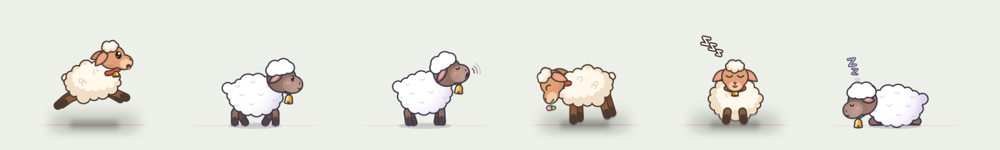

# Mouflon

**A light and beautiful desktop companion manager.**<br>
*Un gestionnaire de compagnons de bureau, léger et beau.*

[English](#english) · [Français](#français)



## English

Mouflon brings little companions to your Mac. They drop from the top of the
screen, stroll along your windows and ride with them when you move them, climb
the edges of the screen, graze, bleat, doze off — and let you catch them and
throw them across the desktop.

- **Light**: a native menu bar app, drawn by the GPU. Images follow the
  display's own clock (its full rate in motion, 30 fps at rest, 20 fps
  asleep), a sprite is redrawn only when its image changes, and the window
  list is read on a separate thread (often only while a window carrying a pet
  moves), so it never holds up an image.
- **Beautiful**: continuous 120 Hz physics, timed to the moment each image
  reaches the display (ProMotion included), sub-pixel motion, in-between
  images for smoother animations, sharp pixel-exact images at rest, soft
  shadows, dust on landing.
- **Compatible with desktopPet**: Mouflon reads the pets of
  [desktopPet](https://github.com/Adrianotiger/desktopPet) (eSheep 64 and the
  community's pets) as they are, with all their scenes: climbing the screen
  edges, walking on the ceiling, going down windows, secondary characters,
  pets that meet and do things together, window sides that block the way.
- **And much more**: sounds (bleats, a little bell, grazing; desktopPet pets'
  own sounds too), high-definition sheets for desktopPet pets, a native format
  with images drawn for both directions, pets that greet each other or tumble
  in collision mode, *All Together*, a goodbye before leaving, four sizes, pets
  you can catch without leaving the app you are working in, pets that walk on
  the Dock (or under it) and on floating panels such as the Keyboard Viewer,
  install by drag and drop, a menu in the language of macOS (English, French,
  Spanish, German, Italian, Dutch, Portuguese, Russian, Japanese, Korean,
  Chinese).
- **Written entirely in Rust**: `unsafe` code only at the boundary with macOS,
  in a single crate, each block justified.

### Mascots

| | |
|---|---|
| **Poete** | The mascot of Mouflon, a painted sheep. It lives in its own repository and waits for the permission of its original creator before being shared. |
| **Pelote** | A soft wool sheep with a collar and a bell (`pets/pelote`): the desktopPet behaviors, drawn in high definition. |
| **Lainou** | A small wool sheep with a bell (`pets/lainou`): 26 animations drawn frame by frame, in both directions. |
| Mannequin | The built-in test character, a vector rig animated by Mouflon (`pets/mannequin`). |

### Requirements

- A Mac with Apple Silicon (M1 or later), macOS 27 Golden Gate
  (`MIN_MACOS=26.0` to accept Tahoe as well).
- [Rust](https://rustup.rs) 1.90 or later (`rustup update`) and the Xcode
  command line tools (`xcode-select --install`).

### Run

```sh
cargo run --release
```

Launched from the repository, Mouflon also loads the pets of `pets/` and of the
`animaux/` folder: Poete drops onto your frontmost window if it is there,
Pelote otherwise. The menu bar icon adds pets, gets them all to play together,
says goodbye to them, pauses, turns collisions on, lets them walk under the
Dock, changes their size, opens the pets folder and shows *About Mouflon*.

Pets walk on the Dock. With *Walk Under the Dock*, they go down to the bottom of
the screen, pass behind the Dock and can jump onto it. To know where the Dock
really is, Mouflon needs the Accessibility permission (System Settings →
Privacy & Security → Accessibility), which it uses for nothing else; the ⓘ item
just below the option says so. The option is not required. Launched with
`cargo run`, the permission goes to the terminal app.

To try a pet without installing it, pass its file or folder: it is loaded with
the others, and it is the one that appears.

```sh
cargo run --release -- path/to/esheep64
```

To check that the animation is smooth, `MOUFLON_ESSAI=300` runs Mouflon for
five minutes and writes a full journal (`mouflon-essai.log` in the current
folder, or the file named by `MOUFLON_JOURNAL`): every image (gap, time spent
in each part, state of each pet), every event (collisions, landings, sounds,
windows, menu), a summary every ten seconds and a report at the end.
`MOUFLON_ESSAI_ANIMAUX=lainou,lainou,pelote` chooses the pets of the trial and
`MOUFLON_ESSAI_COLLISIONS=1` turns collisions on. The CI runs such a trial on
every Mac build.

```sh
MOUFLON_ESSAI=300 MOUFLON_ESSAI_COLLISIONS=1 cargo run --release
```

The `essais/` and `animaux/` folders are ignored by git: keep test pets and
pets you do not publish there.

### Build the app

```sh
bash scripts/bundle-macos.sh     # dist/Mouflon.app, ad hoc signature
```

The app bundles the repository's pets (`pets/`) and those of the `animaux/`
folder, such as Poete (`animaux/poete`). At first launch, Poete greets the user
if it is bundled, Pelote otherwise. Only put pets there that you are allowed to
distribute. `APP_ICON=path/to/icon.png` replaces the app icon (1024 × 1024).

A distributable build, signed with Developer ID and notarized:

```sh
# Once: store the notarization credentials in the keychain.
xcrun notarytool store-credentials mouflon --apple-id <your Apple ID> --team-id <TEAMID>

SIGN_IDENTITY="Developer ID Application: Alejandro San Martin Lamas (TEAMID)" \
NOTARY_PROFILE=mouflon bash scripts/bundle-macos.sh
```

#### Mac App Store

```sh
APPSTORE=1 TEAM_ID=<TEAMID> \
SIGN_IDENTITY="Apple Distribution: Alejandro San Martin Lamas (TEAMID)" \
INSTALLER_IDENTITY="3rd Party Mac Developer Installer: Alejandro San Martin Lamas (TEAMID)" \
PROVISION_PROFILE=~/Downloads/Mouflon_Mac_App_Store.provisionprofile \
bash scripts/bundle-macos.sh
```

The script signs the app for the sandbox (`packaging/macos/AppStore.entitlements.in`),
embeds the provisioning profile and produces `dist/Mouflon-<version>-<build>.pkg`,
to upload with the Transporter app. The `animaux/` folder is not bundled in this
version (`APPSTORE_ANIMAUX=1` to include it).

While developing, sign your builds with your “Apple Development” certificate
rather than ad hoc: macOS ties some permissions (such as Accessibility) to the
signature, and an ad hoc signature changes with every build.

#### Releases from GitHub

The `.github/workflows/ci.yml` workflow tests every commit, builds the bundle
on macOS and, for a `v*` tag, signs, notarizes and publishes a release when
these repository secrets exist: `APPLE_CERTIFICATE` (Developer ID certificate
exported as .p12, base64-encoded), `APPLE_CERTIFICATE_PASSWORD`,
`APPLE_SIGN_IDENTITY`, `APPLE_ID`, `APPLE_TEAM_ID`, `APPLE_APP_PASSWORD`
(app-specific password).

### Add pets

Menu → *Open the Pets Folder*
(`~/Library/Application Support/com.alejandrosanmartinlamas.Mouflon/pets`).
The folder accepts:

- a folder in Mouflon's format: a `pet.toml` and its drawing;
- a desktopPet pet as it is: its `animations.xml` file, or its whole folder
  (for example `Pets/esheep64` from the desktopPet repository);
- a pet made of images: one strip of images per animation and per direction,
  described by a `pet.toml` (see [docs/format.md](docs/format.md#animaux-en-images)
  and `pets/lainou`);
- a redrawn desktopPet pet: its original behaviors with a finer sheet,
  described by a small `pet.toml` (see [docs/format.md](docs/format.md#redessiner-un-animal-desktoppet)
  and `pets/pelote`).

A pet dropped in the folder appears in the menu without restarting the app.
Even simpler: drag its file or folder from the Finder onto a pet on screen. It
is installed, and the pet you dropped it on makes way for it.

To draw your own character: [docs/rig.md](docs/rig.md); to tune its behaviors:
[docs/format.md](docs/format.md) (both in French).

### Architecture

| Crate | Role | `unsafe` |
|---|---|---|
| `mouflon-core` | physics, behaviors, pet formats, world (screens, visible window ledges) | forbidden |
| `mouflon-render` | SVG rig, procedural animation, shadow, light, particles; Vello or SVG output | forbidden |
| `mouflon-platform` | other apps' windows, screens, cursor, languages, the Dock (Accessibility), non-activating pet windows | isolated and commented |
| `mouflon-app` | transparent windows (winit), GPU (wgpu), input, native menu, translations | forbidden |
| `tools/mouflon-preview` | off-screen preview: poses, video scene, flock, encounter, image sheet, icon | forbidden |
| `tools/mouflon-licenses` | gathers the licenses of the libraries built into the app | forbidden |
| `tools/inbetween` | computes the in-between images of a pet, once (Python script, RIFE network), not part of the app | — |

All the app's code is Rust. Only the boundary with macOS contains `unsafe`, in
`mouflon-platform`, with a justification for each block. The rest of the
repository is data (pets in TOML, SVG and PNG, translations, documentation),
a build script in bash and a Python script that prepares in-between images.

### Off-screen preview

```sh
cargo run -p mouflon-preview --release -- pets/mannequin/pet.toml apercu all
ffmpeg -framerate 60 -i apercu/frames/frame_%05d.png -c:v libx264 -pix_fmt yuv420p apercu.mp4

# Several pets at their spawn points (30 s, 4 pets):
cargo run -p mouflon-preview --release -- pets/pelote/pet.toml apercu troupeau 30 4

# Two Lainou bumping into each other, then a throw; and all its images as
# Mouflon draws them, in both directions:
cargo run -p mouflon-preview --release -- pets/lainou/pet.toml apercu rencontre
cargo run -p mouflon-preview --release -- pets/lainou/pet.toml apercu planche
```

With a desktopPet file, a long simulation without display checks that no
behavior gets stuck:

```sh
MOUFLON_DESKTOPPET=path/to/animations.xml \
  cargo test -p mouflon-core --release long_run -- --ignored --nocapture
```

### Roadmap

- Window tracking through accessibility notifications.
- A settings window.
- Windows and Linux (X11; Wayland in a reduced mode).
- A real-time 3D option.

### License

© 2026 **Alejandro San Martin Lamas**. Mouflon is free software, available
under the [MIT License](LICENSE-MIT) or the [Apache License 2.0](LICENSE-APACHE),
at your option: you may use, change and share it freely, including
commercially, as long as the copyright notice with the author's name stays.
The pets of this repository (Pelote, Lainou, the Mannequin) are under the same
licenses. Credits and third-party licenses: [CREDITS.md](CREDITS.md).

## Français

Mouflon fait vivre de petits compagnons sur ton Mac. Ils tombent du haut de
l'écran, se promènent sur tes fenêtres et voyagent avec elles quand tu les
déplaces, escaladent les bords de l'écran, broutent, bêlent, s'endorment — et
se laissent attraper et lancer à travers le bureau.

- **Léger** : une app native de la barre des menus, dessinée par le GPU. Les
  images suivent l'horloge de l'écran lui-même (sa pleine cadence en
  mouvement, 30 i/s au repos, 20 i/s endormi), une image n'est redessinée que
  quand elle change, et la liste des fenêtres est relevée sur un fil à part
  (souvent seulement lorsqu'une fenêtre portant un animal bouge), sans jamais
  retenir une image.
- **Beau** : une physique continue à 120 Hz, calée sur l'instant où chaque
  image arrive à l'écran (ProMotion compris), des mouvements au sous-pixel
  près, des images intermédiaires pour des animations plus fluides, des
  images nettes au pixel près au repos, des ombres douces, de la poussière à
  l'atterrissage.
- **Compatible desktopPet** : Mouflon lit tels quels les animaux de
  [desktopPet](https://github.com/Adrianotiger/desktopPet) (eSheep 64 et ceux
  de la communauté), avec toutes leurs scènes : escalade des bords de l'écran,
  marche au plafond, descente des fenêtres, personnages secondaires, animaux
  qui se rencontrent et font des choses ensemble, côtés des fenêtres qui
  barrent le chemin.
- **Et bien plus** : des sons (bêlements, clochette, broutage ; ceux des
  animaux desktopPet aussi), des planches haute définition pour les animaux
  desktopPet, un format natif aux images dessinées dans les deux sens, des
  animaux qui se saluent, ou qui culbutent en mode collisions,
  « Tous ensemble », un au revoir avant de partir, quatre tailles, des animaux
  qu'on attrape sans quitter l'app où l'on travaille, qui marchent sur le Dock
  (ou dessous) et sur les panneaux flottants comme le visualiseur de clavier,
  l'installation par glisser-déposer, un menu dans la langue de macOS (anglais,
  français, espagnol, allemand, italien, néerlandais, portugais, russe,
  japonais, coréen, chinois).
- **Écrit entièrement en Rust** : du code `unsafe` seulement à la frontière
  avec macOS, dans un seul crate, chaque bloc justifié.

### Les mascottes

| | |
|---|---|
| **Poete** | La mascotte de Mouflon, un mouton peint. Il vit dans son propre dépôt et attend l'accord de son créateur d'origine avant d'être partagé. |
| **Pelote** | Un mouton tout en laine douce, avec son collier et sa clochette (`pets/pelote`) : les comportements de desktopPet, dessinés en haute définition. |
| **Lainou** | Un petit mouton de laine à clochette (`pets/lainou`) : 26 animations dessinées image par image, dans les deux sens. |
| Mannequin | Le personnage de test intégré, un pantin vectoriel animé par Mouflon (`pets/mannequin`). |

### Prérequis

- Un Mac Apple Silicon (M1 ou plus récent), macOS 27 Golden Gate
  (`MIN_MACOS=26.0` pour accepter aussi Tahoe).
- [Rust](https://rustup.rs) 1.90 ou plus récent (`rustup update`) et les outils
  en ligne de commande Xcode (`xcode-select --install`).

### Lancer

```sh
cargo run --release
```

Lancé depuis le dépôt, Mouflon charge aussi les animaux de `pets/` et du
dossier `animaux/` : Poete tombe sur ta fenêtre au premier plan s'il y est,
sinon Pelote. L'icône de la barre des menus ajoute des animaux, les fait jouer
tous ensemble, leur dit au revoir, met en pause, active les collisions, les
fait marcher sous le Dock, change leur taille, ouvre le dossier des animaux et
affiche « À propos de Mouflon ».

Les animaux marchent sur le Dock. Avec « Marcher sous le Dock », ils descendent
jusqu'en bas de l'écran, passent derrière le Dock et peuvent sauter dessus.
Pour savoir où est vraiment le Dock, Mouflon a besoin de l'autorisation
d'Accessibilité (Réglages Système → Confidentialité et sécurité →
Accessibilité), qui ne lui sert à rien d'autre ; l'article ⓘ juste sous
l'option le dit. L'option est facultative. Lancé avec `cargo run`, c'est le
Terminal qui reçoit l'autorisation.

Pour essayer un animal sans l'installer, passe son fichier ou son dossier en
argument : il est chargé en plus des autres, et c'est lui qui apparaît.

```sh
cargo run --release -- chemin/vers/esheep64
```

Pour vérifier que l'animation est fluide, `MOUFLON_ESSAI=300` lance Mouflon
pour cinq minutes et écrit un journal complet (`mouflon-essai.log` dans le
dossier courant, ou le fichier que nomme `MOUFLON_JOURNAL`) : chaque image
(écart, temps passé dans chaque partie, état de chaque animal), chaque
événement (collisions, atterrissages, sons, fenêtres, menu), un résumé toutes
les dix secondes et un bilan à la fin. `MOUFLON_ESSAI_ANIMAUX=lainou,lainou,pelote`
choisit les animaux de l'essai et `MOUFLON_ESSAI_COLLISIONS=1` met le mode
collisions. L'intégration continue fait un tel essai à chaque construction
pour Mac.

```sh
MOUFLON_ESSAI=300 MOUFLON_ESSAI_COLLISIONS=1 cargo run --release
```

Les dossiers `essais/` et `animaux/` sont ignorés par git : on y garde les
animaux d'essai et ceux qu'on ne publie pas.

### Construire l'app

```sh
bash scripts/bundle-macos.sh     # dist/Mouflon.app, signée en ad hoc
```

L'app emporte les animaux du dépôt (`pets/`) et ceux du dossier `animaux/`,
comme Poete (`animaux/poete`). Au premier lancement, Poete accueille
l'utilisateur s'il est livré, sinon Pelote. N'y mets que des animaux que tu as
le droit de distribuer. `APP_ICON=chemin/vers/icone.png` remplace l'icône de
l'app (1024 × 1024).

Une version distribuable, signée Developer ID et notarisée :

```sh
# Une seule fois : enregistrer les identifiants de notarisation dans le trousseau.
xcrun notarytool store-credentials mouflon --apple-id <ton Apple ID> --team-id <TEAMID>

SIGN_IDENTITY="Developer ID Application: Alejandro San Martin Lamas (TEAMID)" \
NOTARY_PROFILE=mouflon bash scripts/bundle-macos.sh
```

#### Mac App Store

```sh
APPSTORE=1 TEAM_ID=<TEAMID> \
SIGN_IDENTITY="Apple Distribution: Alejandro San Martin Lamas (TEAMID)" \
INSTALLER_IDENTITY="3rd Party Mac Developer Installer: Alejandro San Martin Lamas (TEAMID)" \
PROVISION_PROFILE=~/Downloads/Mouflon_Mac_App_Store.provisionprofile \
bash scripts/bundle-macos.sh
```

Le script signe l'app pour le bac à sable (`packaging/macos/AppStore.entitlements.in`),
y place le profil d'approvisionnement et produit `dist/Mouflon-<version>-<build>.pkg`,
à envoyer avec l'app Transporter. Le dossier `animaux/` n'est pas livré dans
cette version (`APPSTORE_ANIMAUX=1` pour l'inclure).

En développement, signe tes builds avec ton certificat « Apple Development »
plutôt qu'en ad hoc : macOS rattache certaines autorisations (comme
l'Accessibilité) à la signature, et une signature ad hoc change à chaque
compilation.

#### Publier depuis GitHub

Le workflow `.github/workflows/ci.yml` teste chaque commit, construit le bundle
sur macOS et, pour un tag `v*`, signe, notarise et publie une version si ces
secrets existent dans le dépôt : `APPLE_CERTIFICATE` (certificat Developer ID
exporté en .p12, encodé en base64), `APPLE_CERTIFICATE_PASSWORD`,
`APPLE_SIGN_IDENTITY`, `APPLE_ID`, `APPLE_TEAM_ID`, `APPLE_APP_PASSWORD`
(mot de passe pour app).

### Ajouter des animaux

Menu → « Ouvrir le dossier des animaux »
(`~/Library/Application Support/com.alejandrosanmartinlamas.Mouflon/pets`).
Le dossier accepte :

- un dossier au format Mouflon : un `pet.toml` et son dessin ;
- un animal desktopPet tel quel : son fichier `animations.xml`, ou tout son
  dossier (par exemple `Pets/esheep64` du dépôt desktopPet) ;
- un animal en images : une bande d'images par animation et par sens, décrite
  par un `pet.toml` (voir [docs/format.md](docs/format.md#animaux-en-images) et
  `pets/lainou`) ;
- un animal desktopPet redessiné : ses comportements d'origine avec une planche
  plus fine, décrite par un petit `pet.toml` (voir
  [docs/format.md](docs/format.md#redessiner-un-animal-desktoppet) et `pets/pelote`).

Un animal déposé dans le dossier apparaît dans le menu sans relancer l'app.
Plus simple encore : fais glisser son fichier ou son dossier depuis le Finder
sur un animal à l'écran. Il est installé, et l'animal visé lui laisse sa place.

Pour dessiner ton propre personnage : [docs/rig.md](docs/rig.md) ; pour régler
ses comportements : [docs/format.md](docs/format.md).

### Architecture

| Crate | Rôle | `unsafe` |
|---|---|---|
| `mouflon-core` | physique, comportements, formats d'animaux, monde (écrans, rebords visibles des fenêtres) | interdit |
| `mouflon-render` | rig SVG, animation procédurale, ombre, lumière, particules ; sortie Vello ou SVG | interdit |
| `mouflon-platform` | fenêtres des autres apps, écrans, curseur, langues, Dock (Accessibilité), fenêtres d'animaux non activantes | isolé et commenté |
| `mouflon-app` | fenêtres transparentes (winit), GPU (wgpu), entrées, menu natif, traductions | interdit |
| `tools/mouflon-preview` | aperçu hors écran : poses, scène vidéo, troupeau, rencontre, planche d'images, icône | interdit |
| `tools/mouflon-licenses` | réunit les licences des bibliothèques compilées dans l'app | interdit |
| `tools/inbetween` | calcule une fois pour toutes les images intermédiaires d'un animal (script Python, réseau RIFE), hors de l'app | — |

Tout le code de l'app est en Rust. Seule la frontière avec macOS contient de
l'`unsafe`, dans `mouflon-platform`, avec une justification pour chaque bloc.
Le reste du dépôt est fait de données (animaux en TOML, SVG et PNG,
traductions, documentation), d'un script de construction en bash et d'un
script Python qui prépare les images intermédiaires.

### Aperçu hors écran

```sh
cargo run -p mouflon-preview --release -- pets/mannequin/pet.toml apercu all
ffmpeg -framerate 60 -i apercu/frames/frame_%05d.png -c:v libx264 -pix_fmt yuv420p apercu.mp4

# Plusieurs animaux à leurs points d'apparition (30 s, 4 animaux) :
cargo run -p mouflon-preview --release -- pets/pelote/pet.toml apercu troupeau 30 4

# Deux Lainou qui se rentrent dedans, puis un lancer ; et toutes ses images
# telles que Mouflon les dessine, dans les deux sens :
cargo run -p mouflon-preview --release -- pets/lainou/pet.toml apercu rencontre
cargo run -p mouflon-preview --release -- pets/lainou/pet.toml apercu planche
```

Avec un fichier desktopPet, une longue simulation sans affichage vérifie
qu'aucun comportement ne bloque :

```sh
MOUFLON_DESKTOPPET=chemin/vers/animations.xml \
  cargo test -p mouflon-core --release long_run -- --ignored --nocapture
```

### Feuille de route

- Suivi des fenêtres par notifications d'accessibilité.
- Fenêtre de réglages.
- Windows et Linux (X11 ; Wayland en mode dégradé).
- Option 3D temps réel.

### Licence

© 2026 **Alejandro San Martin Lamas**. Mouflon est un logiciel libre, sous
[licence MIT](LICENSE-MIT) ou [licence Apache 2.0](LICENSE-APACHE), au choix :
on peut l'utiliser, le modifier et le partager librement, y compris
commercialement, tant que la mention de copyright avec le nom de l'auteur
reste. Les animaux de ce dépôt (Pelote, Lainou, le Mannequin) sont sous les
mêmes licences. Crédits et licences des tiers : [CREDITS.md](CREDITS.md).
